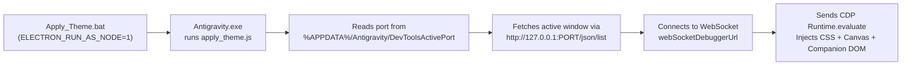

# How to Create Custom Themes & Interactive Companions for Antigravity 2.0

This guide explains both the **1-Prompt Lazy Method** (where Antigravity AI builds the folder, theme script, and `.bat` file for you automatically) and the manual technical breakdown.

---

## ⚡ The "Lazy" 3-Step Method (Let AI Do 100% of the Work)

You don't even need to create the folder or write a single line of code yourself—**Antigravity AI can create the folder, write the JavaScript injector, generate the `.bat` launcher, and inject the theme into itself live.**

### Step 1: Pick Your Assets (Optional)
- If you want a **background video** or **pop-out clip** (`.mp4`) or a **character image/sprite** (`.png` / `.webp`), just download it and copy its file path (e.g. `C:\Users\YourName\Downloads\my_clip.mp4`).
- If you want a **pure color/CSS theme**, you don't need to download anything!

### Step 2: Copy & Paste This Master Prompt into Antigravity Chat
Open **Antigravity 2.0**, start a chat, and paste this exact prompt (just replace the `[brackets]` with what you want):

```text
Create a custom live-injected theme for my Antigravity 2.0 Desktop app based on [CHARACTER / SHOW / STYLE NAME]:

1. Create a new folder at "C:\Users\<YOUR_USERNAME>\.gemini\antigravity\themes\<Theme_Name>".
2. Write a Node script "apply_<theme>_theme.js" that:
   - Reads the active Chrome DevTools port from "%APPDATA%\Antigravity\DevToolsActivePort".
   - Connects to http://127.0.0.1:<port>/json/list and injects into the active page via WebSocket "Runtime.evaluate".
   - Injects a <style id="custom-antigravity-theme"> tag with a custom color palette for [CHARACTER / SHOW], custom user/agent chat bubbles, and custom hover effects.
   - IMPORTANT UI FIXES:
     * Put the main background on "html, body" and keep "#root, .bg-background, .sticky, .md-sticky-message-bleed" transparent with "box-shadow: none !important" so there are no nested background shadow boxes.
     * Style ".settings-modal-container, .settings-modal-container .bg-background, [role='dialog'], [role='menu'], [role='listbox']" with a 97% opaque dark background so Settings stays readable.
     * Include "button[data-testid='automations-button']" alongside "aside a" so the sidebar Automations button matches the theme.
   - (Optional) If using local videos/images, convert them to Base64 -> Uint8Array -> Blob -> URL.createObjectURL(blob) (and set video.muted = true before video.play()), or key out black backgrounds on a <canvas>.
   - (Optional) Add an interactive character companion that walks around the screen perimeter, says character lines when clicked, and has a right-click command menu (with a ".flip-below" class when y < 230 so the speech bubble never clips at the top).
3. Create a portable "Apply_<Theme>_Theme.bat" launcher in the same folder using:
   @echo off
   set ELECTRON_RUN_AS_NODE=1
   "%LOCALAPPDATA%\Programs\antigravity\Antigravity.exe" "%~dp0apply_<theme>_theme.js"
4. Run the script right now using Antigravity.exe with ELECTRON_RUN_AS_NODE=1 (piped to "| Out-String") so my Antigravity window transforms immediately!
```

### Step 3: Double-Click the `.bat` File Anytime Later
- Antigravity will create the folder, write `apply_<theme>_theme.js` and `Apply_<Theme>_Theme.bat`, and immediately apply the theme to your open window.
- Next time you open Antigravity, just go to `C:\Users\<YOUR_USERNAME>\.gemini\antigravity\themes\<Theme_Name>` and **double-click `Apply_<Theme>_Theme.bat`** (or create a Desktop shortcut to it) to turn your theme on in 1 second!

---

## 1. How It Works Under the Hood (Architecture)

Antigravity 2.0 Desktop is an Electron application (`Antigravity.exe`) that exposes a local Chrome DevTools Protocol (CDP) debugging port stored in `%APPDATA%\Antigravity\DevToolsActivePort`.

Even if you do not have Node.js installed on your system, **`Antigravity.exe` has a full Node.js runtime built inside it** when launched with the environment variable `ELECTRON_RUN_AS_NODE=1`.



---

## 2. Step-by-Step: Create Your Own Theme from Scratch

### Step 1: Create Your Theme Folder & `.bat` Launcher

Create a new folder for your theme (for example, `My_Custom_Theme/`) and add a batch launcher `Apply_My_Theme.bat`:

```bat
@echo off
set ELECTRON_RUN_AS_NODE=1
"%LOCALAPPDATA%\Programs\antigravity\Antigravity.exe" "%~dp0apply_my_theme.js"
echo.
echo [+] Custom Theme Applied!
timeout /t 2 >nul
```

> **Why `%LOCALAPPDATA%` and `%~dp0`?**
> Using `%LOCALAPPDATA%\Programs\antigravity\Antigravity.exe` and `%~dp0` makes your launcher portable across any Windows user's PC regardless of their username or where they cloned the repository.

---

### Step 2: Create the Injector Script (`apply_my_theme.js`)

Create `apply_my_theme.js` in the same folder. Below is a clean, ready-to-use starter template that connects to the live Antigravity window, cleans up any previous theme elements, and injects your custom CSS:

```js
const fs = require('fs');
const path = require('path');

async function main() {
    // 1. Read active DevTools port from Antigravity's AppData folder
    const appData = process.env.APPDATA || path.join(process.env.USERPROFILE, 'AppData', 'Roaming');
    const portFile = path.join(appData, 'Antigravity', 'DevToolsActivePort');
    let port = 58215;
    if (fs.existsSync(portFile)) {
        const lines = fs.readFileSync(portFile, 'utf8').trim().split(/\r?\n/);
        if (lines[0]) port = parseInt(lines[0], 10);
    }

    // 2. Discover active Antigravity renderer pages
    const listRes = await fetch(`http://127.0.0.1:${port}/json/list`);
    const targets = await listRes.json();
    const pages = targets.filter(t => t.type === 'page');

    if (pages.length === 0) {
        console.error('No active Antigravity window found.');
        process.exit(1);
    }

    for (const page of pages) {
        await injectIntoPage(page.webSocketDebuggerUrl);
    }
}

function injectIntoPage(wsUrl) {
    return new Promise((resolve, reject) => {
        const ws = new WebSocket(wsUrl);

        ws.onopen = () => {
            const expression = `(async function() {
                // Clean up elements/timers from other themes before injecting
                [
                    'eldritch-bg-video',
                    'eldritch-vignette-overlay',
                    'eldritch-rift-header',
                    'prescript-fate-canvas',
                    'prescript-hand-bg',
                    'prescript-vignette-overlay',
                    'prescript-header-insignia',
                    'capri-companion-root',
                    'capri-lightning-canvas',
                    'capri-top-popout'
                ].forEach(id => {
                    const el = document.getElementById(id);
                    if (el) el.remove();
                });

                // Create or update the <style id="custom-antigravity-theme"> tag
                let style = document.getElementById('custom-antigravity-theme');
                if (!style) {
                    style = document.createElement('style');
                    style.id = 'custom-antigravity-theme';
                    document.head.appendChild(style);
                }

                style.textContent = \`
                    :root, .dark, .theme-dark, body {
                        --background: transparent !important;
                        --sidebar: #0A0413 !important;
                        --card: #11061E !important;
                        --card-border: rgba(255, 30, 86, 0.58) !important;
                        --border: rgba(255, 30, 86, 0.28) !important;
                        --foreground: #FDF2F6 !important;
                        --secondary-foreground: #C89EB4 !important;
                    }

                    html, body {
                        background-color: #07030D !important;
                        color: #FDF2F6 !important;
                    }

                    #root, .bg-background, .sticky, .md-sticky-message-bleed {
                        background: transparent !important;
                        box-shadow: none !important;
                    }
                \`;

                return 'Custom Theme Injected!';
            })()`;

            ws.send(JSON.stringify({
                id: 1,
                method: 'Runtime.evaluate',
                params: { expression, awaitPromise: true, returnByValue: true }
            }));
        };

        ws.onmessage = (event) => {
            const data = JSON.parse(event.data);
            if (data.id === 1) {
                console.log('Result:', data.result?.result?.value || data.error);
                ws.close();
                resolve();
            }
        };

        ws.onerror = reject;
    });
}

main().catch(console.error);
```

---

## 3. Antigravity 2.0 UI Selectors Cheat Sheet & Gotchas

When styling Antigravity 2.0, use these verified selectors and watch out for the common pitfalls discovered while building our themes:

| UI Component | CSS Selector | Notes / Gotchas |
| :--- | :--- | :--- |
| **Main Background** | `html, body` | Put your main background color/gradient on `html, body` with `background-attachment: fixed !important;`. |
| **Nested Layout Containers** | `#root, .bg-background` | **Gotcha**: Antigravity puts `.bg-background` on many small nested divs (like the sticky message row). Always set `.bg-background { background: transparent !important; }` so nested boxes don't draw opaque rectangles over your background! |
| **Sticky Top Prompt Row** | `.md-sticky-message-bleed, .sticky` | Set `background: transparent !important; box-shadow: none !important;` and hide `.md-sticky-message-bleed::after { display: none !important; }`. |
| **Settings Modal & Dialogs** | `.settings-modal-container, .settings-modal-container .bg-background, [role="dialog"], [role="menu"], [role="listbox"]` | **Gotcha**: Because `.bg-background` is made transparent, the Settings popup will become see-through unless you explicitly give `.settings-modal-container` a high-contrast dark background (e.g. `rgba(8, 3, 16, 0.97) !important`). |
| **Sidebar Navigation & Automations** | `aside a, button[data-testid="automations-button"]` | **Gotcha**: Most sidebar items are `<a>` tags, but **Automations** is a `<button data-testid="automations-button">`. Include both selectors so Automations matches the rest of your sidebar! |
| **Titlebar** | `[class*="@container/titlebar"]` | Top window drag bar. |
| **User Message Bubbles** | `[class*="group/user-input-step"] .bg-card-border` and `[class*="group/user-input-step"] .bg-card` | Outer border wrapper and inner card of user chat messages. |
| **Agent Response Panels** | `.gap-y-3 > .flex.items-start:not(:has([class*="group/user-input-step"])) > .flex-col` | AI assistant message containers. |
| **Bottom Prompt Input Box** | `.rounded-2xl.bg-card-border` and `.rounded-2xl.bg-card-border > .bg-card` | The main chat input composer at the bottom of the window. |
| **Inline Code & File Pills** | `code:not(pre code), .inline-pill` | Clickable file badges and inline code spans inside responses. |

---

## 4. How to Load Custom Videos, Images & Transparent Sprites

### Why `file:///` URLs Don't Work
Antigravity's renderer runs on a secure origin (`https://127.0.0.1:<port>`). Chromium blocks local `file:///C:/...` images and videos from loading directly inside an `https://` page.

### Solution A: Base64 -> `Blob` URL for `<video>` Elements
Read the `.mp4` file in Node (`fs.readFileSync(VIDEO_PATH).toString('base64')`), pass the base64 string into your injected script, and convert it into an in-memory `Blob` URL:

```js
// Inside the injected browser function:
const binStr = atob("${videoBase64}");
const bytes = new Uint8Array(binStr.length);
for (let i = 0; i < binStr.length; i++) {
    bytes[i] = binStr.charCodeAt(i);
}
const blob = new Blob([bytes], { type: 'video/mp4' });
const videoBlobUrl = URL.createObjectURL(blob);

const video = document.createElement('video');
video.src = videoBlobUrl;
// IMPORTANT: Chromium requires muted = true before calling play() for autoplay!
video.muted = true;
video.defaultMuted = true;
video.setAttribute('muted', '');
video.loop = true;
video.play();
```

### Solution B: Automatic Background Removal for Character Sprites (`<canvas>`)
If your character or emblem image (`.webp` / `.png`) has a solid black background (`#000000`), you can chroma-key it out automatically on an offscreen `<canvas>` using flood-fill from the image borders before converting it to `canvas.toDataURL('image/png')`.
- See [`Capri/apply_capri_theme.js`](./Capri/apply_capri_theme.js) (lines 113–190) or [`Prescript/apply_prescript_theme.js`](./Prescript/apply_prescript_theme.js) (lines 88–150) for the full edge-flood-fill implementation.

---

## 5. How to Build Interactive Screen Companions & VFX

You can inject interactive DOM overlays (`position: fixed; z-index: 9999;`) and full-screen `<canvas>` layers (`pointer-events: none;`) to bring characters to life:

1. **60fps Companion Loop (`requestAnimationFrame`)**:
   - Store your companion's state (`x`, `y`, `targetX`, `targetY`, `mode`, `moveEnabled`, `attackEnabled`) and update its position with `transform: translate3d(x, y, 0)`.
   - Keep target waypoints along the screen perimeter (bottom rail, left/right margins, top bar) so the character never blocks the center workspace.
2. **Speech Bubble & Right-Click Command Menu**:
   - Listen for `click` (to speak character quotes) and `contextmenu` (right-click to open a custom command console).
   - **Tip**: When the character walks near the top of the window (`y < 230`), toggle a `.flip-below` CSS class (`bottom: auto !important; top: 124px !important;`) so the speech bubble and context menu flip below the character instead of clipping off the top edge.
3. **Top Ceiling Video Pop-Out**:
   - Position a container at `top: 0; transform: translate(-50%, -120%); opacity: 0; visibility: hidden;` and toggle `.active` (`transform: translate(-50%, 0%); opacity: 1; visibility: visible;`) on a timer or command to make the character drop down from the top bar of Antigravity.

---

## 6. How to Ask Antigravity AI to Build a Theme for You

You can ask Antigravity itself to generate a complete theme by giving it a prompt following the workflow used to build this repository:

### Example Prompt 1 — Pure Character Theme + Hover Effects
> *"Research [Character Name] from [Show/Game] and recreate the closest theme to their color palette in `C:\Users\<you>\.gemini\antigravity\themes\<ThemeName>` with an `apply_<theme>.js` script and `.bat` launcher. Make sure the Settings modal stays dark and readable, sync the sidebar Automations button color, and add a custom hover effect matching their abilities."*

### Example Prompt 2 — Interactive Companion + Right-Click Console
> *"Add an interactive companion using `<path-to-sprite.webp>` that walks around the screen perimeter without covering the center workspace, says character-accurate lines when clicked, occasionally interacts with chat boxes using a `<canvas>` visual effect, and opens a right-click command menu where I can toggle movement, toggle effects, or chat with them."*

### Example Prompt 3 — Top Ceiling Video Pop-Out
> *"Using `<path-to-video.mp4>` (from `0:00` to `0:06`), make the character periodically pop out from the top bar of Antigravity as an interactive ceiling rift portal, and add a button in the right-click menu to trigger it on demand."*
